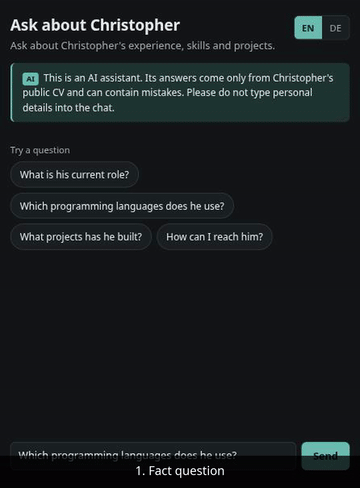
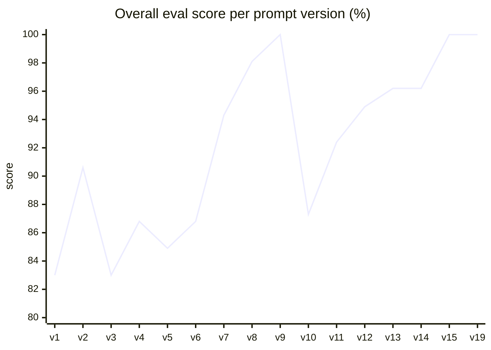

# Recruiter assistant

> **Local-only project.** There is no public live version, because a public bot would need a legal notice and privacy policy and, for EEA users, paid Gemini API terms. Run it locally with the steps below.

A chat assistant that answers recruiters' questions about Christopher, grounded in his public profile, in English or German. It declines off-topic questions and prompt-injection tries, and it opens a contact form when a visitor wants to reach him.



Full demo (39 s): [docs/demo/demo.mp4](docs/demo/demo.mp4). The contact form stops at the opened form, nothing is sent.

## Scores

Every prompt version is scored against a fixed golden set (`evals/history.csv`). The chart shows the overall score of the last run of each version.



The golden set grew from 53 cases (v1 to v9) to 79 (v10 to v15) and 80 cases (v19), and the harder cases explain the dip at v10. Details: `evals/history.csv` and `docs/adr/`.

## Run locally

You need [uv](https://docs.astral.sh/uv/), Python 3.13 and a Gemini API key from Google AI Studio (the free tier is enough for a demo).

1. `uv sync`
2. `cp .env.example .env`, then put your key in `.env` (variable names are in `.env.example`: `GEMINI_API_KEY`, `MODEL_APP`, `MODEL_JUDGE`).
3. Chat in the terminal: `uv run python -m app.cli "Where does Christopher work?"`
4. Or run the web chat. Start the backend (exactly one worker, see below), with Cloudflare's published Turnstile test secret, which always passes:

   ```sh
   ALLOWED_ORIGIN=http://localhost:8000 \
   TURNSTILE_SECRET=1x0000000000000000000000000000000AA \
   uv run uvicorn app.main:app --port 7860 --workers 1 --no-proxy-headers
   ```

5. In `web/config.js` set `API_BASE` to `http://localhost:7860` and `TURNSTILE_SITE_KEY` to the test site key `1x00000000000000000000AA` (do not commit this change), then serve the page: `python3 -m http.server 8000 -d web` and open http://localhost:8000.

Leave `RESEND_API_KEY` and `CONTACT_TO` unset: the contact form then answers 503 and no email is sent. To use Claude instead of Gemini, see "Evals" below.

## Server (M6)

`uv run uvicorn app.main:app --port 7860 --workers 1 --no-proxy-headers` (see "Run locally"; exactly 1 worker: chat history lives in process memory, ADR-010).

- `POST /session` with `{}` (or `{"turnstile_token": "..."}` when `TURNSTILE_SECRET` is set) returns `{"token", "expires_in", "turns_left"}`.
- `POST /chat` with `Authorization: Bearer <token>` and exactly `{"message": "..."}` returns `{"reply", "show_form", "lang", "turns_left"}`. Any other field gives 422, a missing or forged token 401 `invalid_session`, an expired or lost session 401 `session_expired`, more than 1,000 characters 413, a running request for the same session 409.
- `POST /contact` with the token and `{"email", "message", "turnstile_token"}` sends one email through Resend; 503 when `RESEND_API_KEY` or `CONTACT_TO` is missing.
- `GET /health` returns the prompt version.

Env names are in `.env.example`. The `Dockerfile` and `docs/DEPLOY.md` describe the earlier public deployment. They are not in use (see the note at the top).

## Tests

`uv run pytest` makes no model calls and needs no key. The real-model cases of the blackbox tests run only with `BB_REAL=1 uv run pytest tests/blackbox` (about 24 Claude calls, reads the key from `.env`).

## Evals

`uv run npx promptfoo@0.126.0 eval -c evals/promptfooconfig.yaml --env-file .env --no-cache -o evals/results/latest.json`, then `uv run python evals/record.py evals/results/latest.json` adds a row to `evals/history.csv`. One run takes about an hour on the free tier. Never start two runs at the same time.

Eval modes (ADR-009), all from the repo root:

- `uv run python evals/run.py fast [--groups fact,unk] [--ids fact-en-01] [--failing old.json] [--changed <git-ref>]`: code checks only, nothing recorded. A selection always adds the safety groups (disc, inj, con).
- `uv run python evals/run.py version [--compare evals/results/<previous version>.json]`: one full judged run, the official row in `evals/history.csv`.
- `uv run python evals/run.py release`: 3 judged runs, majority per case. Only for the final version and v5. It resumes: a run file that exists is kept.

Noise: the app model ignores `temperature`, so two runs of the same prompt differ. With 53 cases one case is about 1.9 points, and a 1-run gain of 3 to 5 cases can be noise. The cases in `evals/unstable.txt` do not count towards "better". German results are a count (for example "9 of 10"), never a percentage.

To grade saved answers again without new app calls: `REPLAY_FROM=<old results>.json uv run npx promptfoo@0.126.0 eval -c evals/promptfooconfig.yaml -r file://replay.py --env-file .env --no-cache -o <new>.json`. Judge verdicts are cached in `evals/.judge-cache.jsonl` (not committed).

Claude rows in `evals/history.csv` (model_app `claude-haiku-5-5`, judge `claude-sonnet-5-5`) are NOT comparable with the Gemini baseline (rows 418f1ce): other app model, other judge. Run with `PROVIDER_APP=anthropic PROVIDER_JUDGE=anthropic MODEL_APP=... MODEL_JUDGE=...`. A full Claude run costs about 0.25 USD.
